

  

# Arquitetura

A aplicação FastAPI executa um grafo LangGraph. O [grafo](https://github.com/Solierrr/ai-assistant/blob/main/src/workflow/graph/graph.py) reúne guardrail de entrada, resumo, roteador, especialistas, orquestrador, juiz e guardrail de saída.

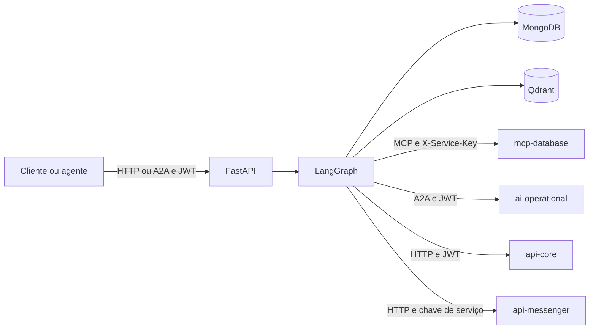

O código se divide entre `src/api/`, com as rotas e os schemas, `src/workflow/`, com a execução e a revisão das respostas, e `src/agents/`, com os especialistas e os prompts. Os clientes externos ficam em `src/infra/`, e `src/rag/` mantém a ingestão e a recuperação do FAQ.

| Integração | Uso |
|---|---|
| `api-auth` | Validação JWT por JWKS público |
| `mcp-database` | Ferramentas de recomendação com `X-Service-Key` e suporte a chave legada |
| `api-core` | Unidades da pessoa, com JWT |
| `api-messenger` | Conversas, mensagens e etapas |
| `ai-operational` | Delegação A2A com JWT e persona |
| Qdrant e provedores LLM | Recuperação vetorial e geração |

JWT e persona ficam no contexto da requisição, fora do estado persistido. O runner usa lock em memória por conversa e compara o dono salvo no checkpoint. A leitura desse dono, porém, continua em caso de erro no checkpoint. Essa limitação não deve ser confundida com isolamento entre réplicas.

A delegação operacional encerra o grafo diretamente, para preservar o texto da proposta, enquanto os demais especialistas voltam ao roteador. A memória e os índices estão descritos em `database/`, a versão vem de `version.txt`, o readiness confere o Mongo com limite de dois segundos e a telemetria registra etapas e custos, com rastreamento opcional.

## Ecossistema de IA e diagramas

Os 5 serviços de IA e como se ligam:

| Serviço | Papel | Fala com |
|---|---|---|
| `ai-assistant` (este) | Agente principal: recomenda placas, profissionais e empresas, responde dúvidas da plataforma e calcula estimativas solares | Usuário (web), `ai-operational` e `ai-geographic` (A2A) |
| `ai-operational` | Operar o SaaS: guiar tarefas, mostrar dados do usuário e executar ações só com aceite explícito | Só o `ai-assistant` (A2A) |
| `ai-geographic` | Copiloto de campo do profissional: rota, clima e potencial solar | App mobile; delega produtos ao `ai-assistant` (A2A) |
| `ai-validation` | Valida certificados NR-10 e NR-35 e CNPJ de empresas | `web-app` (REST, com o JWT do usuário) |
| `ai-accessibility` | Modera imagens e sugere texto alternativo | Serviço interno (REST, chave de serviço) |

## 1. Visão de alto nível

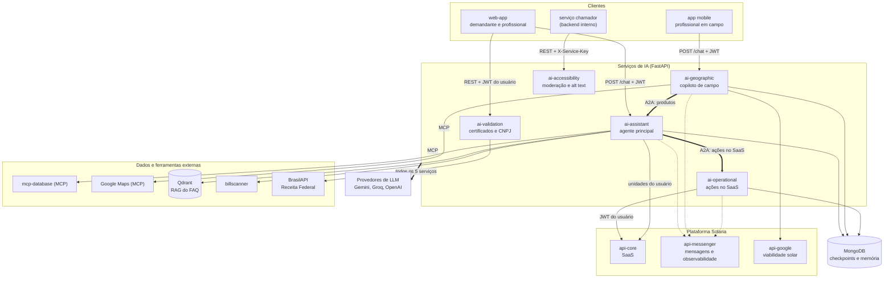

Linhas grossas entre serviços de IA são chamadas entre agentes (A2A); as tracejadas até o `api-messenger` são o registro das mensagens e dos passos de cada turno. O JWT do usuário é emitido pelo `api-auth` e validado por cada serviço que recebe conversa. O JWT do usuário atravessa a cadeia inteira: o `ai-geographic` repassa o do profissional ao `ai-assistant`, e o `ai-assistant` repassa o do usuário ao `ai-operational`, que o usa no `api-core`. Assim cada serviço age com as permissões de quem pediu, nunca com uma credencial própria mais ampla.

## 2. Como uma mensagem percorre o grafo

O grafo é um `StateGraph` do LangGraph (`src/workflow/graph/graph.py`) com 12 nós. O roteador escolhe um especialista por vez; cada especialista devolve o resultado ao roteador, que decide se já há informação suficiente (até 3 especialistas por pedido, `MAX_SPECIALISTS_PER_REQUEST`) e só então chama o orquestrador.

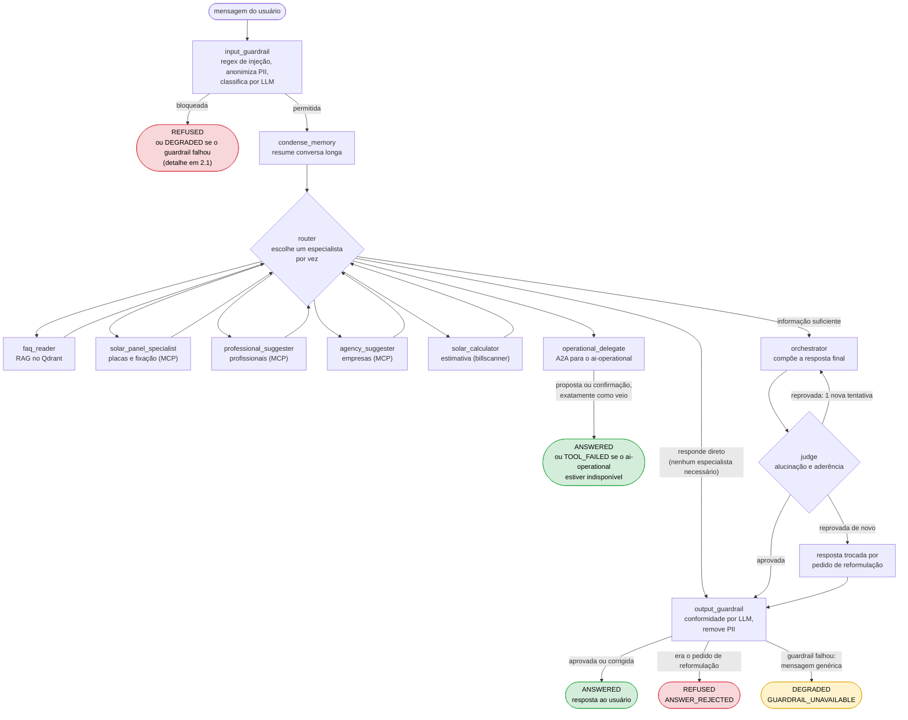

Verde é sucesso (`ANSWERED`), vermelho é recusa e amarelo é degradação. Quando o roteador não precisa de especialista (por exemplo, uma saudação), ele responde direto e a resposta segue para o guardrail de saída, sem passar pelo juiz. Os dois guardrails e o juiz têm caminho próprio para recusa e falha; eles estão detalhados nas subseções 2.1 a 2.3.

### 2.1 Guardrail de entrada

Antes de qualquer especialista, a mensagem passa por três filtros em sequência. Se a avaliação falha, o guardrail bloqueia (fail-closed): nunca deixa passar o que não conseguiu avaliar.

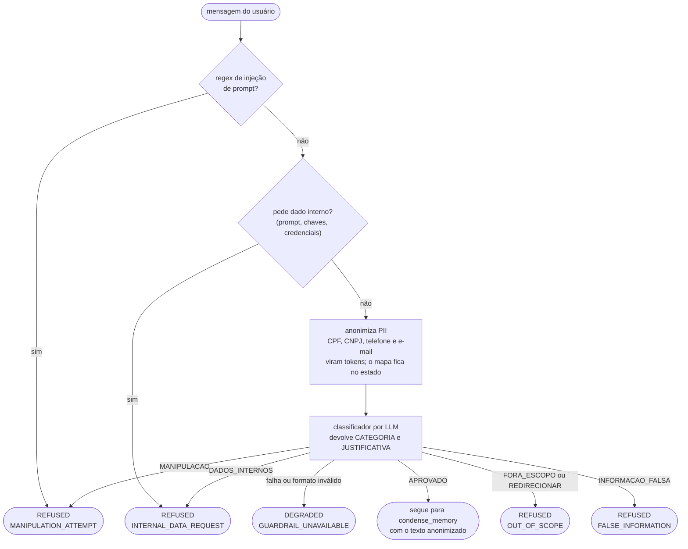

Toda recusa devolve a mesma mensagem ao usuário ("não posso processar essa solicitação por políticas de segurança"), sem revelar qual filtro barrou.

### 2.2 Juiz, recusa da resposta e guardrail de saída

O orquestrador escreve a resposta, mas quem decide se ela sai é o juiz, uma chamada separada. Se a resposta é reprovada, ela é apagada do estado e o orquestrador refaz uma vez; se reprovar de novo, o usuário recebe um pedido para reformular a pergunta.

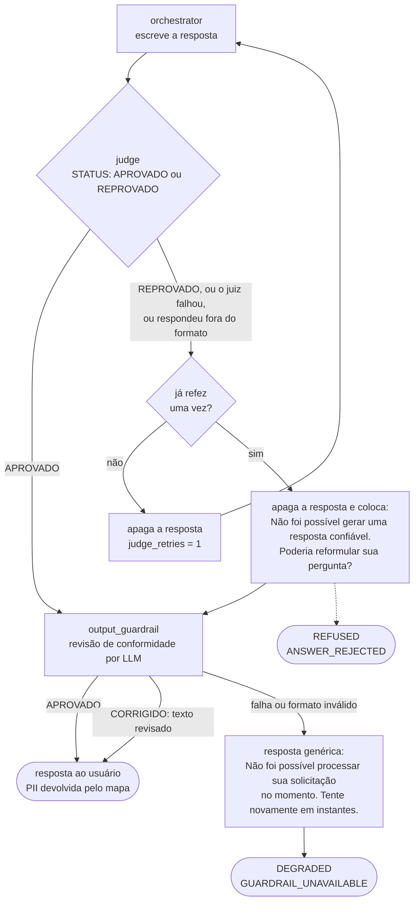

Um juiz que falha conta como reprovação: a resposta só sai se o juiz disser explicitamente que aprova.

### 2.3 Como o resultado do turno é decidido

O `/chat` sempre responde 200 para o que acontece dentro da conversa e informa o desfecho em `outcome` e `reason`, lidos dos passos registrados no turno (`src/api/outcome.py`).

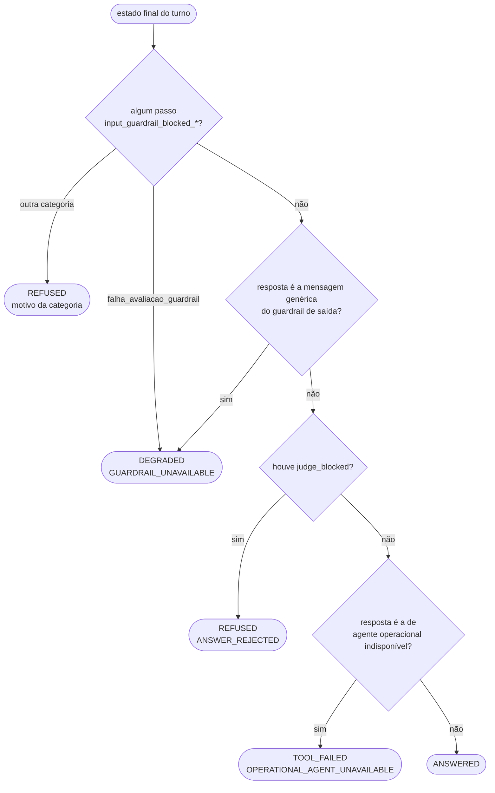

Pontos que explicam o desenho:

- **Hub e raios.** Todo especialista volta ao roteador. Isso permite combinar fontes (por exemplo, FAQ e recomendação de placas) sem acoplar um especialista ao outro, e um especialista novo entra registrando a rota em `src/workflow/config.py`.
- **Atalho do agente operacional.** A resposta do `operational_delegate` não passa pelo orquestrador, pelo juiz nem pelo guardrail de saída: uma proposta de ação precisa chegar ao usuário exatamente como foi escrita pelo agente que a vai executar, e esse agente já aplicou os guardrails dele. Quando ele espera a decisão do usuário (aceitar, recusar, questionar), o estado guarda `awaiting_decision` e a próxima mensagem volta direto a ele.
- **Juiz com uma nova tentativa.** Se o juiz reprova, o orquestrador refaz a resposta uma vez (`MAX_JUDGE_RETRIES = 1`); reprovada de novo, o turno termina como `REFUSED / ANSWER_REJECTED`.
- **Falha não é erro.** O que acontece dentro da conversa volta como `200` com `outcome` e `reason` (`ANSWERED`, `REFUSED`, `DEGRADED`, `TOOL_FAILED`), para o cliente tratar sem confundir com falha de infraestrutura.

## 3. Delegação A2A

O A2A (Agent2Agent, JSON-RPC) é como um agente pede trabalho a outro sem conhecer o interior dele. O módulo é o `ai_lib.a2a` da `solaria-lib`; cada serviço publica um Agent Card em `GET /.well-known/agent-card.json` e recebe chamadas em `POST /a2a`.

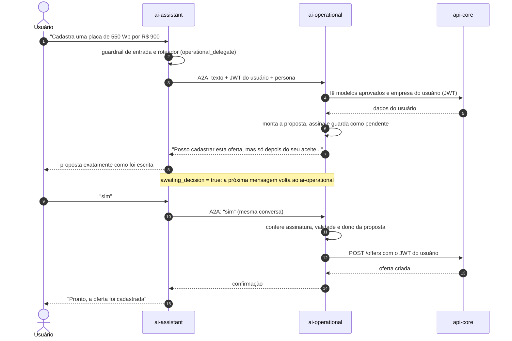

A ligação no sentido contrário é a do `ai-geographic`: quando o profissional em campo pergunta sobre produtos, o copiloto delega ao `ai-assistant`.

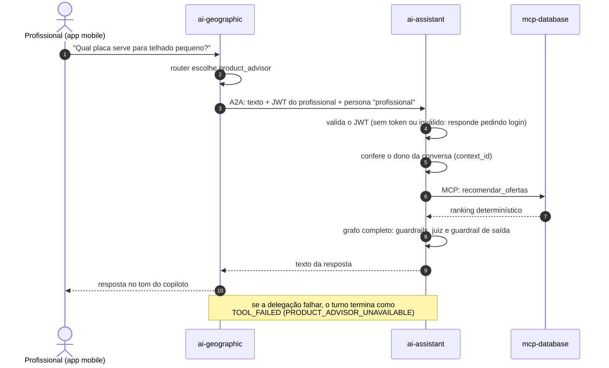

Com a persona `profissional` o assistente recomenda só com dados públicos, sem usar unidade nem empresa cadastradas.

Nada grava sem o aceite exato do usuário. A proposta é assinada (HMAC), expira em 15 minutos, é presa ao usuário que a pediu e há um teto de gravações por conversa. As regras estão descritas no `docs/ARCHITECTURE.md` do `ai-operational`.

## 4. Dados e memória

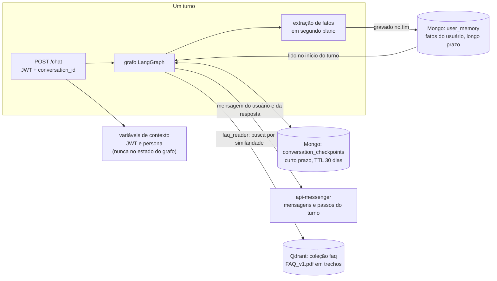

| Camada | Onde | Para quê |
|---|---|---|
| Sessão por usuário | `thread_id` no checkpointer do LangGraph (Mongo) | Continuar a conversa entre turnos e reinícios; o acesso é conferido por usuário (`conversation_access`) |
| Longo prazo | `user_memory` no Mongo | Fatos do usuário aprendidos em conversas anteriores |
| Histórico e observabilidade | `api-messenger` | Cada turno grava a mensagem do usuário, a resposta e os passos (`StepTracker`) |
| RAG | Qdrant, coleção `faq` | O `faq_reader` busca trechos do `FAQ_v1.pdf` e responde citando a fonte |

O JWT e a persona ficam em variáveis de contexto porque o checkpointer grava o estado inteiro no Mongo: um token no estado seria persistido.

### 4.1 O ciclo de um turno no `runner`

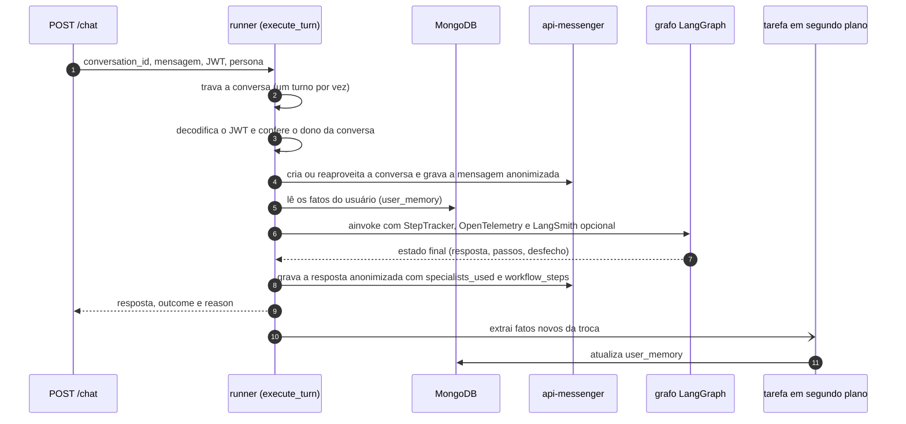

### 4.2 RAG do FAQ

A fonte externa indicada é o `FAQ_v1.pdf`, indexado no Qdrant Cloud. O índice é montado fora da requisição e consultado durante o turno.

**Ingestão** (`python -m src.rag.indexing.ingest_faq`, `src/rag/vectorstore/qdrant_store.py`):

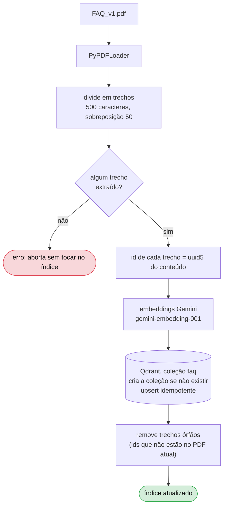

**Consulta durante um turno** (`faq_reader_node` e `faq_retriever`):

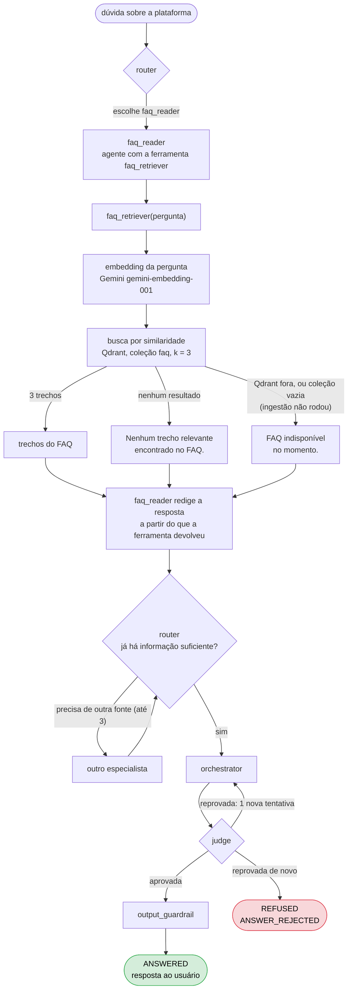

O índice é criado pela ingestão. Em qualquer um dos três resultados da busca, o `faq_reader` responde com o que a ferramenta devolveu, e o desfecho do turno segue as regras da seção 2.3. Quem confere a resposta final contra alucinação é o juiz.

## 5. Observabilidade e custo

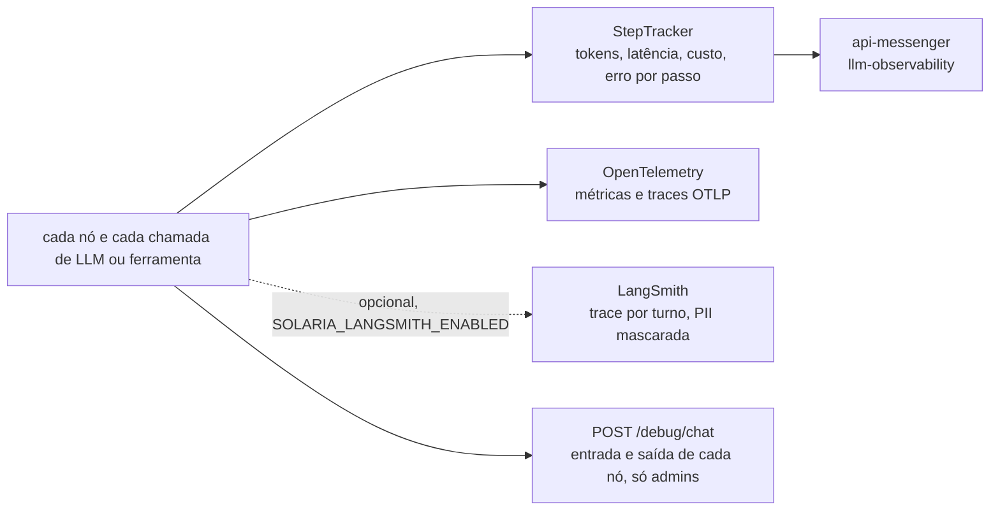

O requisito de SRE da disciplina e onde cada item está:

| Item | Situação |
|---|---|
| Custo por chamada | Existe: `costUsd` por passo, calculado dos tokens e da tabela de preços `src/core/config/model_pricing.py` |
| Latência entre agentes e tempo total | Registrada por passo no `StepTracker` e enviada ao `api-messenger` |
| Índice de erros | Cada passo de erro é registrado com categoria (`rate_limited`, `timeout`, `connection_error`), e todo turno devolve `outcome` e `reason` |

## 6. Requisitos da disciplina e onde cada um está

| Requisito (Inteligência Artificial, mínimo para o 7,0) | Onde está |
|---|---|
| API em FastAPI | `src/api/app.py` (`/chat`, `/health`, `/ready`, `/a2a`) |
| Multiagente, no mínimo 5 agentes | 8 agentes com prompt próprio (roteador, orquestrador, juiz, FAQ, especialista em placas, sugestor de profissionais, sugestor de empresas, calculador solar) e o nó que delega ao `ai-operational`; fora deste serviço há ainda os agentes do `ai-operational` e do `ai-geographic` |
| LangChain para os agentes | `src/agents/base/base_agent.py` (`build_agent`) e um módulo de prompt por agente |
| LangGraph para orquestração | `src/workflow/graph/graph.py` |
| Sessões por usuário | JWT validado por requisição e `thread_id` por conversa, com checagem de dono |
| Memória de longo prazo | `user_memory` (`src/workflow/memory/memory_extraction.py`) |
| MCP e A2A | MCP com o `mcp-database` (`src/infra/mcp/client.py`); A2A como servidor (`src/a2a/server.py`) e como cliente (`operational_delegate_node.py`) |
| RAG com fonte externa indicada | `faq_reader` com Qdrant (`src/rag/`), fonte `FAQ_v1.pdf`; recomendações vêm do `mcp-database` e da `api-recommendation` |
| Juiz contra alucinação | `src/workflow/nodes/judge_node.py` |
| Guardrail | Entrada e saída: regex de injeção, anonimização de PII, classificação e revisão por LLM |
| Observabilidade e SRE | Seção 5 |
| Desenho de arquitetura de alto nível | Seção 1 deste documento |

## 7. Complexidade do projeto

O que torna este projeto mais do que um chatbot com um prompt:

1. **Orquestração com estado.** 12 nós, arestas condicionais, laço do roteador com limite de especialistas e laço do juiz com nova tentativa, tudo sobre um estado tipado persistido a cada passo.
2. **Três protocolos de integração.** REST para clientes e serviços da plataforma, MCP para ferramentas de dados e Google Maps, A2A para falar com outros agentes. Cada um tem autenticação e falhas próprias, e o desfecho de cada falha chega ao usuário de forma clara (`TOOL_FAILED` com motivo).
3. **Cadeia de agentes entre serviços.** O assistente é ao mesmo tempo servidor A2A (recebe do `ai-geographic`) e cliente A2A (delega ao `ai-operational`). O JWT do usuário precisa atravessar os dois saltos sem ser guardado no estado e sem dar mais permissão do que o usuário tem.
4. **Segurança em camadas.** Validação do JWT (RS256 por JWKS), checagem de dono da conversa, regex de injeção e de pedido de dados internos, anonimização de PII (CNPJ, CPF, telefone, e-mail) com remoção na saída, classificação por LLM na entrada e revisão de conformidade por LLM na saída, juiz contra alucinação e, para ações, aceite explícito do usuário.
5. **Três tipos de memória** com ciclos de vida diferentes: checkpoints com TTL de 30 dias, fatos de longo prazo extraídos em segundo plano e histórico no `api-messenger`.
6. **Tolerância a falhas de LLM.** Três provedores (Gemini, Groq, OpenAI) com ordem configurável e fallback entre eles, e degradação explícita (`DEGRADED`) quando o guardrail não consegue avaliar.
7. **Duas personas** (`demandante` e `profissional`) que mudam o que o agente pode ler e recomendar.
8. **Observabilidade por passo**, com custo por chamada, mais um modo debug para administradores que mostra a entrada e a saída de cada nó e permite reexecutar um nó com o prompt editado.
9. **Contrato e qualidade automatizados.** OpenAPI gerado do código e conferido no CI, erros em `application/problem+json`, `ruff`, `pytest` com cobertura e SonarQube.
